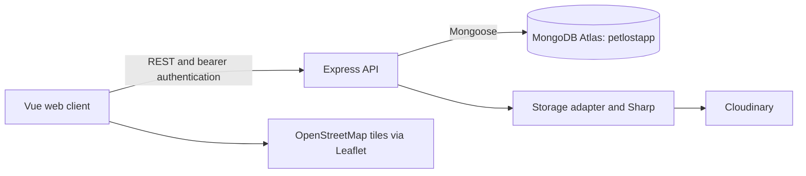

# PawRadar - Hyperlocal Lost Pet Recovery & Sighting Platform

PawRadar helps pet owners, community reporters and shelter staff coordinate lost-pet recovery through nearby reports, sightings, maps and direct communication. It is a mobile-first Vue web application with a 480px content shell, English/Traditional Chinese/Simplified Chinese, and light/dark themes.

This repository supports an **HKBU Final Year Project** and a provisional **ISA second progress report**. The official assessment brief and supervisor instructions have not yet been supplied; no specific rubric, deadline or assessment compliance is assumed.

**Documentation snapshot: 29 October 2026.** The web workflows are implemented, with the limitations below. This is not a production-release or usability sign-off. The latest approved workflow repairs remain uncommitted application work.

## For supervisor review

1. Start with [PROGRESS: achievements, current work and next steps](docs/PROGRESS.md#progress-at-a-glance).
2. Review the [requirement-to-evidence matrix](docs/PROGRESS.md#requirements-and-implementation-evidence), then the [verification categories and limitations](docs/PROGRESS.md#verification-and-command-safety). Technical tests are distinct from user evaluation.
3. Discuss the [risks and evaluation needs](docs/PROGRESS.md#risks-planned-work-and-evaluation-needs) and [provisional ISA evidence gaps](docs/PROGRESS.md#provisional-isa-second-progress-report-evidence-gaps). Detailed backend and historical reports are linked from PROGRESS for optional reference.

Optional follow-up: [technical reference](docs/technical/BACKEND_OVERVIEW.md), [developer handover](docs/development/HANDOVER.md), and the dated evidence linked from PROGRESS. The existing `verification/` tree remains in place; no archived browser reports or runtime artifacts were relocated.

## Current capabilities

| State | Capabilities and limits |
| --- | --- |
| Implemented | Authentication, profile/contact privacy, persistent appearance/language, lost-pet reporting, sightings/history/trajectory, reunion, QR flyers, contact links, messaging/read state, rescue posts/comments/saves and shelter moderation. |
| Implemented | Radar animal/district/radius controls; an independent viewport-based Map; privacy-safe hotspots from sightings/rescue reports; Area Insights counting eligible Pet reports. Backend breed filtering remains available; Radar no longer has a breed input. |
| Implemented, evaluation pending | Explainable Smart Match ranks manually entered species/breed/location criteria using fixed rules. Photos are not analyzed; scores are not calibrated probabilities. |
| Partially complete | Managed image writes cover avatar, pet, sighting, rescue and chat. Existing Base64/local/external images remain readable; historical migration is unfinished. In-app radius alerts exist, but background push does not. |
| Planned/deferred | Physical-device/user evaluation, labelled matching evaluation, production deployment validation and legacy-image migration. Native packaging, cross-device saved pets and exports are not current completion claims. |

See the [requirement/evidence matrix and provisional ISA progress report](docs/PROGRESS.md), [feature status](docs/development/FYP_FEATURE_GAP.md), and [current handover](docs/development/HANDOVER.md).

## Architecture and stack



The browser never connects to MongoDB or receives provider credentials/signed provider URLs. Public discovery uses approximate locations; private information requires the relevant authorization. GeoJSON is stored as `[longitude, latitude]` with `2dsphere` indexes. See [backend routes/models](docs/technical/BACKEND_OVERVIEW.md) and [design decisions](docs/PROGRESS.md#engineering-decisions-and-trade-offs).

| Layer | Technology; manifest ranges where specified |
| --- | --- |
| Client | Vue 3.5, TypeScript 5.7, Vue Router 4, Vite 8, Axios `^1.20.0`, Vue I18n 11 |
| Mapping | Leaflet 1.9, marker clustering and `leaflet.heat` |
| Server | Node.js ES modules, Express `^4.22.3`, Mongoose 8, JWT, bcryptjs, Helmet |
| Images | Cloudinary adapter, Multer, file-type and Sharp |
| Verification | Vitest/Vue Test Utils, Node tests, disposable local MongoDB replica-set harness |

Exact dependency declarations are in [root](package.json) and [server](server/package.json) manifests and their lockfiles. Capacitor packages are present; physical-device/native readiness is not established. Shared theme tokens retain teal/coral accents with warm-neutral light surfaces and charcoal dark surfaces.

## Local setup

Use npm and a Node version compatible with lockfile engine requirements. Existing records used Node 22.20 with a development-tool engine warning; see [runtime limitations](docs/PROGRESS.md#risks-planned-work-and-evaluation-needs).

```sh
npm ci
npm --prefix server ci
```

Copy [server/.env.example](server/.env.example) to `server/.env` and configure it locally. Do not commit runtime environment files, paste secrets into reports, or put secrets in `VITE_` variables.

```dotenv
MONGODB_URI=your_mongodb_atlas_connection_string
PORT=5000
JWT_SECRET=your_jwt_secret_here
ALLOW_TEST_SEED=false
ALLOW_IMAGE_MIGRATION=false
ALLOW_IMAGE_CLEANUP=false
ALLOW_MEDIA_RECONCILIATION=false
IMAGE_UPLOADS_ENABLED=false
```

These are placeholders, not usable credentials. Generate a unique random JWT secret of at least 32 characters; the shown JWT placeholder is explicitly rejected. The connection module selects exactly `petlostapp` even when the URI omits a database. No application command should use `sample_mflix`.

For image-dependent forms, separately configure `IMAGE_STORAGE_PROVIDER`, `MEDIA_NAMESPACE`, `CLOUDINARY_CLOUD_NAME`, `CLOUDINARY_API_KEY`, and `CLOUDINARY_API_SECRET` in `server/.env`, then deliberately enable `IMAGE_UPLOADS_ENABLED`. Uploads are off by default; disabled storage is not proof that integrated image forms work in that environment. [Storage lifecycle and limits](docs/PROGRESS.md#managed-and-historical-images).

Run in separate terminals:

```sh
npm --prefix server start
```

```sh
npm run dev
```

Vite is configured for **http://localhost:3000** with strict port binding; the API defaults to **http://localhost:5000**. Vite proxies `/api` and protected `/uploads` requests. Normal backend startup may initialize collections/indexes. For production, exact CORS origins and deployment-specific proxy trust are required; see [runtime configuration](docs/technical/BACKEND_OVERVIEW.md#runtime-and-database). No production hosting is verified here.

## Verification and safety

```sh
npm run typecheck
npm run lint
npm run test:frontend
npm --prefix server test
npm run build
```

These commands are listed for future use, **not rerun during this documentation work**. Ordinary tests use isolated/mocked dependencies; opt-in real database suites must be run separately.

| Operation | Safety boundary |
| --- | --- |
| Health and `npm run smoke:api` | Read-only HTTP checks against the running backend. Starting the normal backend can initialize indexes. |
| `node server/scripts/verifyManagedImagesReadOnly.js` | Guarded Atlas/API check pinned to `petlostapp`, with collection/index initialization disabled. Requires existing local configuration. |
| `npm --prefix server run test:transactions` | Writes only disposable local replica-set fixtures; provider mocked. May download the MongoDB test binary. |
| Seed, live workflow scripts, reconciliation apply and real-provider verification | **Not routine read-only checks.** Require separate scoped authorization and review; see the [command classification](docs/PROGRESS.md#verification-and-command-safety). |

Recorded results include actual MongoDB, separate real-provider and browser evidence; none establishes user effectiveness by test count alone. [Dated evidence and limits](docs/PROGRESS.md#verification-and-command-safety).

## Project references

- [Progress report and evidence index](docs/PROGRESS.md): provisional ISA structure; official brief/supervisor mapping pending.
- [Audit checklist](docs/development/AUDIT_FINDINGS_CHECKLIST.md): original 22 findings plus separate integration/workflow findings.
- [Backend reference](docs/technical/BACKEND_OVERVIEW.md), [legacy-image permissions](docs/technical/LEGACY_IMAGE_DELIVERY.md), and [dated dependency review](docs/verification/DEPENDENCY_SECURITY_REVIEW.md).
- [Original image-integration report](docs/verification/IMAGE_STORAGE_PHASE2_REPORT.md): historical report; later repair evidence supersedes its pending quota/recovery/verification notes.

Historical identifying configuration remains in Git history despite current generic examples. Do not assume `.gitignore` removes history or that every evidence artifact is approved for public sharing. No paid-service commitment or unrestricted public-deployment approval is implied.
