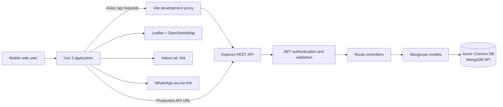

# PawRadar — Hyperlocal Lost Pet Recovery & Sighting Platform

## Milestone 1 Progress Report

**Project domain:** Community safety and animal welfare  
**Platform:** Mobile-first web application  
**Report status:** Milestone 1 implementation baseline  
**Report date:** 15 September 2026

---

## 1. Executive Summary

PawRadar is a hyperlocal lost-pet recovery and community sighting platform designed to reduce the time between an animal being reported missing, being observed by a nearby resident, and its owner receiving actionable information. Conventional social-media posts are distributed broadly but are difficult to search geographically and chronologically. PawRadar addresses this latency by storing reports as geospatial records, retrieving active cases within a configurable radius, and linking successive sightings into a time-ordered movement history.

Milestone 1 delivers an end-to-end web application comprising a Vue 3 mobile interface, an Express REST API, and an Azure Cosmos DB database accessed through the MongoDB API. The system supports authenticated reporting, nearby pet and stray discovery, interactive Leaflet maps, chronological sighting trajectories, community verification, owner/finder communication, and persisted radius alerts.

The current milestone establishes the functional and architectural baseline. The next phase will strengthen test data, edge-case resilience, matching quality, and native packaging without changing the core client/server contract.

## 2. Project Objectives

The project has four primary objectives:

1. Centralize lost-pet reports and community sightings in a searchable, structured repository.
2. Prioritize locally relevant information through database-backed distance queries.
3. Visualize location history so users can interpret the likely movement of an animal.
4. Minimize communication delay through direct contact actions and focused owner/finder messaging.

## 3. Core Technology Stack

| Layer | Technologies | Purpose |
|---|---|---|
| Frontend | Vue 3 Composition API, `<script setup lang="ts">`, TypeScript, Vite, Axios | Reactive mobile-first interface and typed API access |
| Mapping | Leaflet.js, OpenStreetMap tiles | Interactive markers, radius overlays, location history, and viewport fitting |
| Backend | Node.js, Express.js, RESTful controllers, JWT, bcrypt | API orchestration, authentication, validation, and authorization |
| Data | Mongoose, Azure Cosmos DB MongoDB API | Document persistence and geospatial querying |
| Geospatial standard | GeoJSON Point and `2dsphere` indexes | Longitude/latitude validation and spherical distance searches |
| Mobile shell | Responsive CSS constrained to `max-width: 480px` | App-like behavior on mobile browsers and preparation for Capacitor |

The principal interface uses the PawRadar design tokens: deep teal `#1d6360`, urgency coral `#ef6351`, and warm off-white `#fcf9f2`.

## 4. System Architecture



### 4.1 Client/server separation

The Vue client is responsible for presentation, user interaction, geolocation requests, map lifecycle management, and typed HTTP requests. Express owns validation, authorization, serialization, and application rules. Mongoose models define persistence constraints and database indexes. This separation keeps browser code independent from database credentials and permits the same REST API to support a later Capacitor application.

During development, Vite serves the frontend on port `3000` and proxies `/api` to Express on port `5000`. The backend also permits credential-aware requests from localhost and `127.0.0.1` on ports `3000` and `5173`.

### 4.2 Geospatial storage and coordinate integrity

Pet locations, sightings, stray reports, and user alert locations follow the GeoJSON Point convention:

```json
{
  "type": "Point",
  "coordinates": [114.1694, 22.3193]
}
```

The ordering is always **`[longitude, latitude]`**. Leaflet expects `[latitude, longitude]`, so conversion occurs only at the presentation boundary. Schema validation constrains longitude to `-180…180` and latitude to `-90…90`. Explicit `2dsphere` indexes are declared for every geospatial model.

### 4.3 Why spatial indexing occurs in the database

Calculating the distance from every report in application code would require transferring and scanning the complete candidate set for each request. That approach grows linearly with the number of records and prevents the database query planner from eliminating irrelevant locations early.

PawRadar instead uses MongoDB `$geoNear` aggregation with `2dsphere` indexes. The database performs spherical distance filtering and returns ordered candidates with a calculated distance. Ordinary B-tree indexes remain appropriate for scalar fields such as status, species, breed, and district; a `2dsphere` index is purpose-built for GeoJSON geometry and should not be described as a conventional B-tree. Combining spatial and scalar filtering reduces data transfer and keeps geographic selection close to the persistence layer.

The current retrieval model is a circular radius query rather than a rectangular bounding-box query, matching the user-facing “within X km” requirement. Leaflet dynamically fits the displayed bounds for chronological trajectories and renders the selected radius as a map overlay.

### 4.4 Communication design rationale

Recovery scenarios are time-sensitive. PawRadar therefore exposes validated native links for:

- `tel:+<international-number>` to open the device dialler; and
- `https://wa.me/<number>?text=<encoded-message>` to open a pre-addressed WhatsApp conversation.

Local Hong Kong numbers are normalized to the `+852` country code, invalid numbers are rejected, and unavailable contact actions are hidden. These direct protocols provide a zero-setup, low-latency path to the owner or reporter. Authenticated in-app messaging remains available for private asynchronous communication, but it does not obstruct urgent one-tap contact.

## 5. Data and API Design

### 5.1 Principal data models

| Model | Responsibility | Important relationships/indexes |
|---|---|---|
| `User` | Identity, role, contact details, and alert preferences | `alertLocation` uses `2dsphere` |
| `Pet` | Lost-pet report and current recovery status | References reporting user; `location` uses `2dsphere` |
| `Sighting` | Time-stamped observation and verification state | References pet and reporter; `location` uses `2dsphere` |
| `Stray` | Stray-animal welfare report and rescue lifecycle | References reporter; `location` uses `2dsphere` |
| `Message` | Owner/finder conversation record | Scoped by pet and participant |
| `Notification` | Persisted proximity or sighting alert | References recipient, pet, and optional sighting |

Further field-level documentation is available in [`BACKEND_OVERVIEW.md`](BACKEND_OVERVIEW.md).

### 5.2 Implemented API domains

The REST API currently contains 28 registered endpoints across these domains:

- `/api/auth` — registration, login, profile retrieval, and profile update;
- `/api/pets` — reporting, list and nearby retrieval, ownership views, status changes, and sightings;
- `/api/strays` — reporting, list/detail/nearby retrieval, ownership views, and rescue status;
- `/api/chat` — conversation inbox, chronological thread retrieval, and message creation;
- `/api/notifications` — alert retrieval, preferences, and read state; and
- `/api/health` — application and database readiness.

Protected operations require a seven-day JWT in `Authorization: Bearer <token>`. Reporting routes support optional authentication so emergency reports can be submitted by guests while still associating records with a signed-in user when possible.

## 6. Completed Milestones and Deliverables

### 6.1 Centralized pet and sighting tracking — Completed for Milestone 1

- Lost-pet reports can be created, listed, retrieved individually, filtered, and transitioned through `lost`, `sighted`, and `reunited` states.
- Sightings store an independent location, timestamp, note, photograph, reporter reference, and confirmation set.
- A pet’s sightings are retrieved chronologically and rendered as a Leaflet polyline with numbered markers.
- Authenticated users can review their own reports and submitted sightings.
- Community confirmation uses an idempotent `$addToSet` update, preventing duplicate confirmation by one user.

This is a complete operational recovery pipeline rather than unrestricted administrative CRUD. Hard deletion and general record editing are intentionally not exposed in Milestone 1, preserving the recovery history while moderation requirements are defined.

### 6.2 Geospatial radar and interactive mapping — Completed

- Pet, sighting, stray, and alert-location schemas use GeoJSON and explicit `2dsphere` indexes.
- Nearby pet and stray endpoints use `$geoNear`, configurable radius limits, and nearest-first ordering.
- Leaflet renders pet markers, stray-rescue markers, the user’s location, and a radius circle.
- Chronological sightings are connected into a movement trajectory, and the viewport is fitted to the resulting bounds.
- Map initialization handles unavailable location data by presenting a clear fallback and a default Hong Kong center.
- Component teardown disconnects its `ResizeObserver`, cancels pending animation frames, removes event-bound Leaflet layers, and calls `map.remove()`.

### 6.3 Multi-factor filtering — Completed

- Pet search combines radius with species, status, breed, and Hong Kong district.
- Breed matching is case-insensitive and escapes regular-expression metacharacters before querying.
- District values are restricted to the recognized 18 Hong Kong districts.
- Stray discovery supports species, condition, rescue status, district, and radius filters.
- Numeric coordinates and radius inputs are normalized and range-checked by the API.

### 6.4 Stray animal extension — Completed for the rescue workflow

A dedicated `Stray` model separates animal-welfare reports from owned lost-pet cases. The implemented lifecycle is:

```text
Spotted / Needs Rescue (reported)
        → Help Dispatched (rescue_dispatched)
        → In Care / Rescued (rescued)
```

Users can create reports, discover nearby cases, open report details, contact the reporter, and filter by rescue state. Status changes are restricted to the original reporter or a `shelter_admin` user.

### 6.5 Radius alerts and communication — Completed as a web baseline

- Users can store an alert center, enable or disable alerts, and select a radius from 1–50 km.
- New pet reports and sightings generate persisted notifications for eligible nearby users.
- A sighting also alerts the reporting owner where appropriate.
- The web client retrieves notifications and manages individual/all-read state.
- Direct phone, WhatsApp, and authenticated owner/finder chat flows are implemented.

Milestone 1 uses persisted in-app alerts and polling. Native push delivery is deferred until platform packaging and notification permission flows are introduced.

### 6.6 Backend hardening and defensive engineering — Completed

- Centralized error middleware maps validation, identifier, conflict, authorization, and unexpected failures to stable responses.
- Controllers reject missing, empty, primitive, or array request bodies before destructuring.
- Authentication middleware distinguishes required authentication from optional guest access.
- Login attempts are limited by IP address and email over a fixed time window.
- GeoJSON arrays are required when a point is present and are validated for order and range.
- CORS uses an explicit origin allow-list with credentials enabled.
- `server/.env` is resolved relative to the backend source file, making launch behavior independent of the terminal’s current directory.
- Photo payload size, text length, phone format, enum, district, and ObjectId checks are enforced before persistence.

## 7. Quality Assurance Status

| Check | Current status |
|---|---|
| Vue/TypeScript type checking | Available through `npm run typecheck` |
| Production frontend build | Passing |
| Backend route/authentication tests | 6/6 passing |
| API smoke test | Covers health, pet listing, and stray listing against a running database |
| Map lifecycle cleanup | Implemented with `onBeforeUnmount` |
| Defensive location fallback | Implemented |

Current automated backend tests primarily verify route registration and authentication middleware placement. Controller validation, geospatial boundary cases, CORS behavior, and database integration require broader automated coverage during the hardening phase.

## 8. Current Limitations

The following boundaries are recorded to distinguish implemented evidence from future work:

- Smart Match currently calculates a review-priority score using distance and sighting activity; it is not an image-recognition model.
- Server-side nearby retrieval uses circular `$geoNear` queries, not rectangular bounding-box queries.
- Alert records are persisted, but native push notifications are not yet delivered.
- The seed script currently resets and populates pet/sighting demonstration data only; it does not yet create complete users, notifications, chats, and stray-rescue scenarios.
- General edit/delete operations and formal moderation workflows remain outside the Milestone 1 operational lifecycle.
- Native Android/iOS packaging is not part of the verified web milestone.

## 9. Two-Week Development Roadmap

### Week 1 — System hardening and representative data

**Goal:** produce a deterministic, demonstrable web build under normal and adverse conditions.

1. Extend the seed utility with localized Hong Kong clusters containing districts, multiple chronological sightings, strays in each rescue state, alert-enabled users, and owner/finder conversations.
2. Make seeding repeatable and clearly separate destructive development resets from non-destructive demonstration setup.
3. Add controller-level tests for malformed bodies, coordinate order/ranges, radius boundaries, authorization, and expected response shapes.
4. Validate geolocation permission denial, timeout, unavailable-position behavior, and empty filtered results across the main screens.
5. Re-audit Leaflet initialization, watcher invalidation, popup listeners, `ResizeObserver`, animation-frame cancellation, and `map.remove()` behavior.
6. Run type checking, production build verification, route tests, and API smoke checks as one documented pre-demonstration checklist.

**Week 1 acceptance criteria:** repeatable demo data, no unhandled promise rejection in primary flows, stable empty/error states, and clean automated verification.

### Week 2 — Algorithmic enhancement and packaging

**Goal:** improve candidate prioritization and transition the verified web build into native shells.

1. Implement a documented Smart Match heuristic combining:
   - exact species compatibility;
   - normalized breed-token similarity;
   - geospatial distance decay;
   - report/sighting timestamp recency; and
   - supporting sighting activity.
2. Define weights, normalize component scores to a transparent 0–100 range, and retain manual visual confirmation to avoid presenting a heuristic as biometric certainty.
3. Add unit tests using known candidate sets and explain the scoring method in the final report.
4. Freeze the verified production web build and synchronize it with Capacitor.
5. Configure Android and iOS application identifiers, permissions, icons, splash assets, geolocation, camera access, and platform-specific network settings.
6. Conduct physical-device smoke tests for location permission, camera upload, deep links, map interaction, authentication persistence, and API connectivity.

**Week 2 acceptance criteria:** reproducible scoring, explainable ranking results, successful native builds, and documented device-level smoke tests.

## 10. Local Installation and Demonstration

### 10.1 Prerequisites

- A current Node.js LTS release and npm
- Access to an Azure Cosmos DB account using the MongoDB API
- A modern browser with location support

### 10.2 Install dependencies

From the project root:

```powershell
npm install
npm --prefix server install
```

### 10.3 Configure the backend

Create `server/.env` without committing it:

```dotenv
MONGODB_URI=<your-cosmos-mongodb-connection-string>
JWT_SECRET=<a-long-random-secret>
PORT=5000
```

An optional `CORS_ORIGINS` value may contain a comma-separated deployment allow-list. The development defaults permit localhost and `127.0.0.1` on ports `3000` and `5173`.

### 10.4 Seed demonstration data

> **Warning:** the current seed command deletes existing `Pet` and `Sighting` records before inserting the demonstration set. Do not run it against production data.

From the project root:

```powershell
npm --prefix server run seed
```

### 10.5 Start the Express backend

Development mode with automatic restart:

```powershell
npm --prefix server run dev
```

Or production-style local execution:

```powershell
npm --prefix server start
```

The API is available at <http://localhost:5000>, and its health endpoint is <http://localhost:5000/api/health>.

### 10.6 Start the Vue frontend

In a second terminal at the project root:

```powershell
npm run dev
```

The configured development URL is <http://localhost:3000>.

To demonstrate on Vite port `5173` instead:

```powershell
npm run dev -- --port 5173
```

Then open <http://localhost:5173>.

## 11. Verification Commands

Run static and route-level verification:

```powershell
npm test
npm run build
```

With both servers running, validate the API and database:

```powershell
npm run smoke:api
```

Individual checks can also be performed with:

```powershell
curl.exe http://localhost:5000/api/health
curl.exe http://localhost:5000/api/pets
curl.exe "http://localhost:5000/api/pets/nearby?lat=22.3193&lng=114.1694&radiusKm=10"
```

Expected health output includes:

```json
{
  "status": "ok",
  "db": "connected",
  "readyState": 1
}
```

## 12. Milestone 1 Conclusion

Milestone 1 demonstrates that PawRadar’s central proposition is technically viable: structured reports can be located efficiently by radius, enriched through chronological community sightings, visualized on an interactive mobile map, and converted into immediate recovery actions. The architecture separates presentation, API rules, and persistence; adopts the correct geospatial data conventions; and provides a clear path from a verified web application to explainable matching and native delivery.

The next milestone is therefore focused on evidence and robustness rather than architectural replacement: representative datasets, deeper automated tests, a transparent multi-factor ranking algorithm, and controlled Capacitor packaging.
