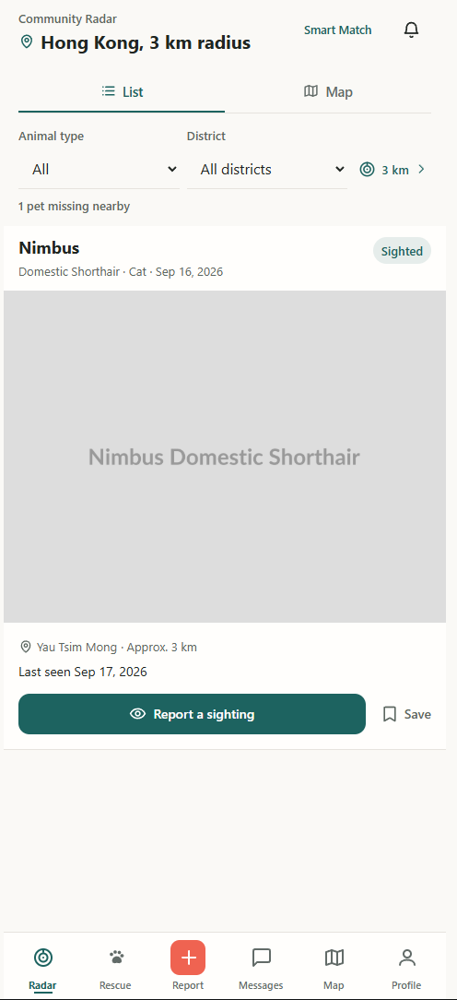
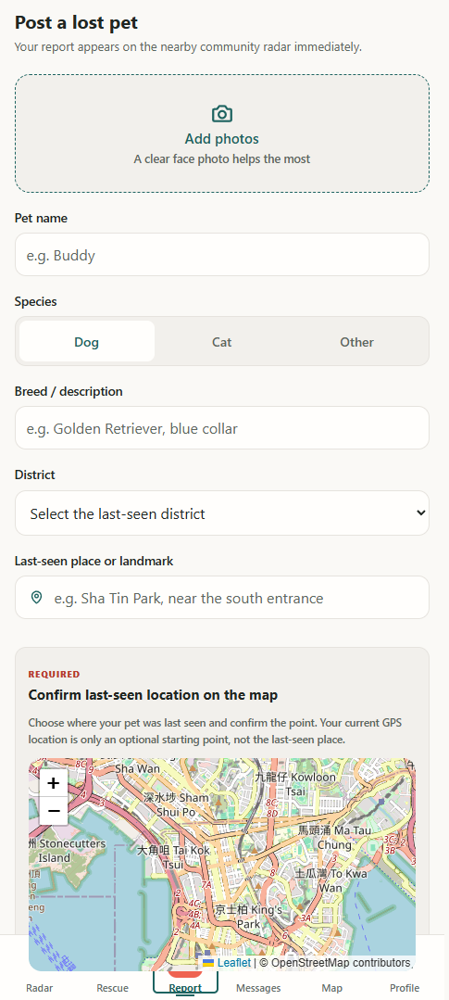
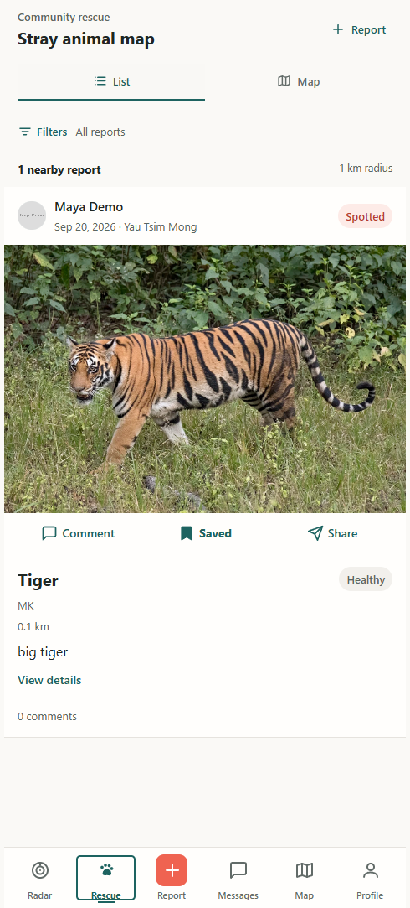
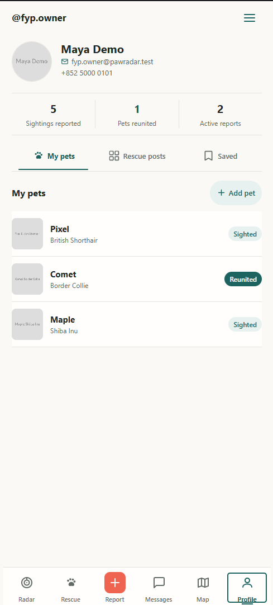
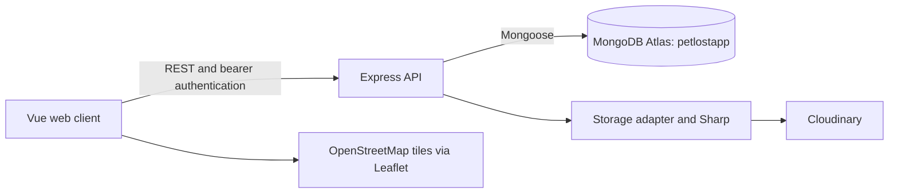

# PawRadar - Hyperlocal Lost Pet Recovery & Sighting Platform

PawRadar helps pet owners, community reporters and shelter staff coordinate lost-pet recovery through nearby reports, sightings, maps and direct communication. It is a mobile-first Vue web application with a 480px content shell, English/Traditional Chinese/Simplified Chinese, and light/dark themes.

This repository supports an **HKBU Final Year Project** and a provisional **ISA second progress report**. The official assessment brief and supervisor instructions have not yet been supplied; no specific rubric, deadline or assessment compliance is assumed.

**Documentation snapshot: 29 October 2026.** The web workflows are implemented, with the limitations below. This is not a production-release or usability sign-off. The latest approved workflow repairs remain uncommitted application work.

## For supervisor review

1. Start with [PROGRESS: achievements, current work and next steps](docs/PROGRESS.md#progress-at-a-glance).
2. Review the [requirement-to-evidence matrix](docs/PROGRESS.md#requirements-and-implementation-evidence), then the [four representative reports and their limitations](docs/PROGRESS.md#evidence-categories). Technical tests are distinct from user evaluation.
3. Discuss the [risks and evaluation needs](docs/PROGRESS.md#risks-planned-work-and-evaluation-needs) and [provisional ISA evidence gaps](docs/PROGRESS.md#provisional-isa-second-progress-report-evidence-gaps). Detailed backend and historical reports are linked from PROGRESS for optional reference.

Use [PROGRESS's evidence index](docs/PROGRESS.md#evidence-categories) for optional historical reports; they remain available at their existing paths.

## Application screenshots

Development screenshots using fictional demonstration data.

<p>
  
  
  
  
</p>

## Current capabilities

| State | Capabilities and limits |
| --- | --- |
| Implemented | Authentication, profile/contact privacy, persistent appearance/language, lost-pet reporting, sightings/history/trajectory, reunion, QR flyers, contact links, messaging/read state, rescue posts/comments/saves and shelter moderation. |
| Implemented | Radar animal/district/radius controls; an independent viewport-based Map; privacy-safe hotspots from sightings/rescue reports; Area Insights counting eligible Pet reports. Backend breed filtering remains available; Radar no longer has a breed input. |
| Implemented, evaluation pending | Explainable Smart Match ranks manually entered species/breed/location criteria using fixed rules. Photos are not analyzed; scores are not calibrated probabilities. |
| Partially complete | Managed image writes cover avatar, pet, sighting, rescue and chat. Existing Base64/local/external images remain readable; historical migration is unfinished. In-app radius alerts exist, but background push does not. |
| Planned/deferred | Physical-device/user evaluation, labelled matching evaluation, production deployment validation and legacy-image migration. Native packaging, cross-device saved pets and exports are not current completion claims. |

See the [requirement/evidence matrix and provisional ISA progress report](docs/PROGRESS.md), [feature status](docs/development/FYP_FEATURE_GAP.md), and [current handover](docs/development/HANDOVER.md).

## Architecture and stack



The browser never connects to MongoDB or receives provider credentials/signed provider URLs. Public discovery uses approximate locations; private information requires the relevant authorization. GeoJSON is stored as `[longitude, latitude]` with `2dsphere` indexes. See [backend routes/models](docs/technical/BACKEND_OVERVIEW.md) and [design decisions](docs/PROGRESS.md#engineering-decisions-and-trade-offs).

| Layer | Technology; manifest ranges where specified |
| --- | --- |
| Client | Vue 3.5, TypeScript 5.7, Vue Router 4, Vite 8, Axios `^1.20.0`, Vue I18n 11 |
| Mapping | Leaflet 1.9, marker clustering and `leaflet.heat` |
| Server | Node.js ES modules, Express `^4.22.3`, Mongoose 8, JWT, bcryptjs, Helmet |
| Images | Cloudinary adapter, Multer, file-type and Sharp |
| Verification | Vitest/Vue Test Utils, Node tests, disposable local MongoDB replica-set harness |

Exact dependency declarations are in [root](package.json) and [server](server/package.json) manifests and their lockfiles. Capacitor packages are present; physical-device/native readiness is not established. Shared theme tokens retain teal/coral accents with warm-neutral light surfaces and charcoal dark surfaces.

## Local setup

Use npm and a Node version compatible with lockfile engine requirements. Existing records used Node 22.20 with a development-tool engine warning; see [runtime limitations](docs/PROGRESS.md#risks-planned-work-and-evaluation-needs).

```sh
npm ci
npm --prefix server ci
```

Copy [server/.env.example](server/.env.example) to `server/.env` and configure it locally. Do not commit runtime environment files, paste secrets into reports, or put secrets in `VITE_` variables.

```dotenv
MONGODB_URI=your_mongodb_atlas_connection_string
PORT=5000
JWT_SECRET=your_jwt_secret_here
ALLOW_TEST_SEED=false
ALLOW_IMAGE_MIGRATION=false
ALLOW_IMAGE_CLEANUP=false
ALLOW_MEDIA_RECONCILIATION=false
IMAGE_UPLOADS_ENABLED=false
```

These are placeholders, not usable credentials. Generate a unique random JWT secret of at least 32 characters; the shown JWT placeholder is explicitly rejected. The connection module selects exactly `petlostapp` even when the URI omits a database. No application command should use `sample_mflix`.

For image-dependent forms, separately configure `IMAGE_STORAGE_PROVIDER`, `MEDIA_NAMESPACE`, `CLOUDINARY_CLOUD_NAME`, `CLOUDINARY_API_KEY`, and `CLOUDINARY_API_SECRET` in `server/.env`, then deliberately enable `IMAGE_UPLOADS_ENABLED`. Uploads are off by default; disabled storage is not proof that integrated image forms work in that environment. [Storage lifecycle and limits](docs/PROGRESS.md#managed-and-historical-images).

Run in separate terminals:

```sh
npm --prefix server start
```

```sh
npm run dev
```

Vite is configured for **http://localhost:3000** with strict port binding; the API defaults to **http://localhost:5000**. Vite proxies `/api` and protected `/uploads` requests. Normal backend startup may initialize collections/indexes. For production, exact CORS origins and deployment-specific proxy trust are required; see [runtime configuration](docs/technical/BACKEND_OVERVIEW.md#runtime-and-database). No production hosting is verified here.

## PawRadar Assistant

Radar's floating chat button opens an in-page panel above the navigation. Reviewed, localized app help is **scripted guidance, not AI** and works without provider configuration. Optional Cloudflare Workers AI responses are genuine AI, labelled separately, and cannot access records, locate pets, upload images or perform application actions. Conversation is bounded in memory and cleared on session changes; submitted AI text is processed externally only after explicit consent.

<details>
<summary>Optional Cloudflare Workers AI Free configuration and verification limits</summary>

Hosted AI is disabled by default. Keep the Cloudflare account on **Workers Free**, without activating billing, upgrading or buying AI Gateway credits. Under Workers AI → Use REST API, use the Workers AI API token template restricted to the intended account and copy its Account ID. A custom token needs Workers AI Read and Edit permissions, as described in the [REST setup guide](https://developers.cloudflare.com/workers-ai/get-started/rest-api/). No deployed Worker or new application is needed: the existing Express backend calls the REST API.

Configure these exact names locally in `server/.env`, preserving all other settings. Keep both switches false initially:

```dotenv
ASSISTANT_AI_ENABLED=false
ASSISTANT_PROVIDER=cloudflare
CLOUDFLARE_AI_MODEL=@cf/qwen/qwen3.8-27b
CLOUDFLARE_ACCOUNT_ID=your_32_character_account_id
CLOUDFLARE_API_TOKEN=your_workers_ai_api_token
CLOUDFLARE_FREE_PLAN_CONFIRMED=false
```

Account IDs must contain exactly 32 hexadecimal characters. Once you have confirmed Workers Free and deliberately want to enable hosted AI, set `CLOUDFLARE_FREE_PLAN_CONFIRMED=true` and `ASSISTANT_AI_ENABLED=true`, then restart the backend. The confirmation is an operator attestation, not an automated billing check or spending cap. Leave AI disabled if the plan is uncertain. Never put the token in frontend variables, Git or chat. Legacy Groq settings are ignored; there is no fallback to them. No billing, paid fallback, provider switching or automatic retry is implemented.

Official documentation reviewed on 7 November 2026 lists [Qwen 3.8 27B](https://developers.cloudflare.com/workers-ai/models/qwen3.8-27b/) and a shared [Free allocation of 10,000 neurons/day](https://developers.cloudflare.com/workers-ai/platform/pricing/), resetting at 00:00 UTC (08:00 Hong Kong time). Free requests fail after the allocation; some other models require paid access. This is not a guaranteed number of messages or uninterrupted availability. The only allowlisted model is `@cf/qwen/qwen3.8-27b`; a paid-only, arbitrary or retired model is not selected automatically.

Application limits: 1,000 UTF-16 code units per question, six prior messages/4,000 code units of context, 24 displayed messages, 32KiB request/provider-response bodies, 768 completion tokens including reasoning, 4,000 code units in the final answer, 20-second provider timeout, two concurrent requests, six requests/minute/IP and 100 AI admissions/24 hours/process. Completed provider content is not cached. Throttles are in memory and reset on process restart; provider Free limits remain the final external boundary. Stop aborts the request but cannot guarantee that already-started provider work consumes no quota. Explicit retry may consume another request; it does not create duplicate displayed user turns.

The public assistant endpoint has no authentication/model/database dependency; its small parser is mounted before ordinary application parsers. Existing application startup still uses the normal database connection. The assistant sends no account token, cookies, profile, coordinates or report data. Its public reviewed-help catalogue is the only application knowledge supplied to the provider. Users must not type private information; this warning is not automatic anonymization. Provider errors are sanitized and cannot sign users out.

[Cloudflare's data policy](https://developers.cloudflare.com/workers-ai/platform/data-usage/) states no model training on Customer Content and limited retention for standard stateless inference, subject to its documented exceptions; operational metadata may be retained. This is distinct from PawRadar's memory-only conversation storage and is not a promise of Hong Kong-only processing. There is no Groq-style ZDR setting or flag in this integration. Requests use the [direct compatible API](https://developers.cloudflare.com/workers-ai/configuration/open-ai-compatibility/) with `store:false`, no AI Gateway, no tools and no stateful features. Only final answer text is returned; reasoning and provider metadata are discarded. The existing consent declaration remains, and reviewed help does not require external processing. This is general reporting guidance, not veterinary or emergency expertise.

Verification uses mocked provider responses, mounted components and isolated local HTTP routes, with database imports forbidden in a module-loading check. No live provider request, Atlas change or browser/device check was performed for this batch. Dashboard accessibility does not verify token permissions, model entitlement, actual inference from Hong Kong or latency. Those, actual account Free settings, output quality in each language and physical mobile-keyboard usability remain unverified. Free-tier exhaustion and errors leave reviewed help available, without silently labelling it AI.

</details>

## Verification and safety

```sh
npm run typecheck
npm run lint
npm run test:frontend
npm --prefix server test
npm run build
```

These commands are listed for future use, **not rerun during this documentation work**. Ordinary tests use isolated/mocked dependencies; opt-in real database suites must be run separately.

| Operation | Safety boundary |
| --- | --- |
| Health and `npm run smoke:api` | Read-only HTTP checks against the running backend. Starting the normal backend can initialize indexes. |
| `node server/scripts/verifyManagedImagesReadOnly.js` | Guarded Atlas/API check pinned to `petlostapp`, with collection/index initialization disabled. Requires existing local configuration. |
| `npm --prefix server run test:transactions` | Writes only disposable local replica-set fixtures; provider mocked. May download the MongoDB test binary. |
| Seed, live workflow scripts, reconciliation apply and real-provider verification | **Not routine read-only checks.** Require separate scoped authorization and review; see the [command classification](docs/PROGRESS.md#verification-and-command-safety). |

Recorded results include actual MongoDB, separate real-provider and browser evidence; none establishes user effectiveness by test count alone. The [PROGRESS evidence index](docs/PROGRESS.md#evidence-categories) is the entry point for representative reports and optional historical detail.

Historical identifying configuration remains in Git history despite current generic examples. Do not assume `.gitignore` removes history or that every evidence artifact is approved for public sharing. No paid-service commitment or unrestricted public-deployment approval is implied.
