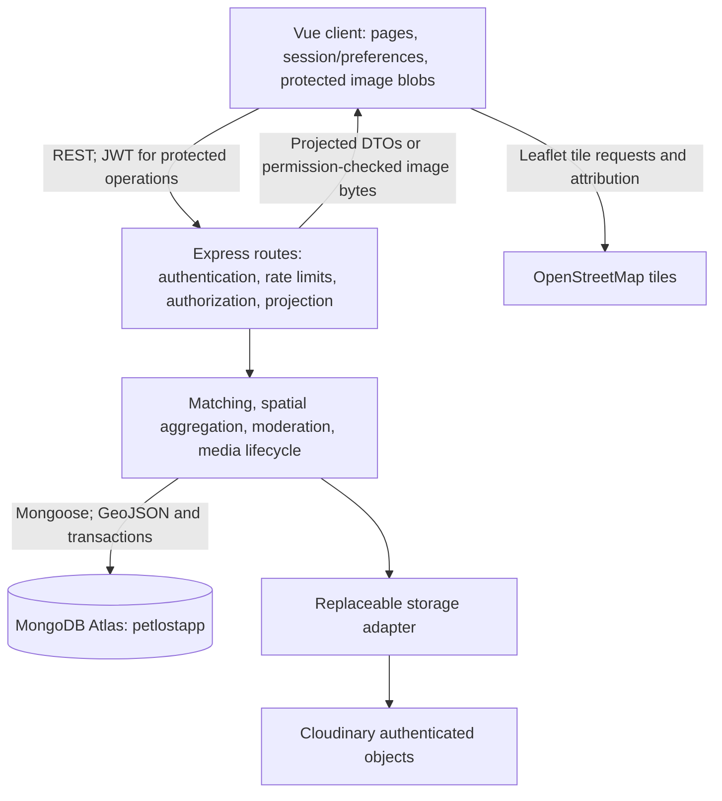
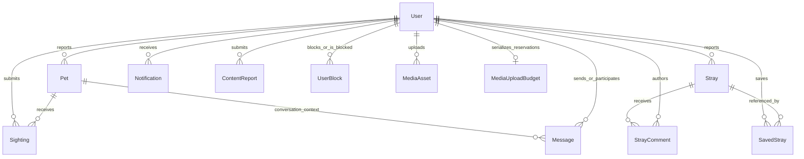

# PawRadar - Technical Progress and Evidence

Snapshot: **29 October 2026**. This document describes the current repository, including approved uncommitted repairs after commit `4ff7e9a`. It is a documentation draft, not a new application verification or production sign-off.

**ISA structure is provisional.** The official assessment brief and dated supervisor instructions were not available in the repository or supplied material reviewed for this draft. Section selection and working requirement IDs below are organizational aids, not official rubric requirements, grading weights or claims of compliance. Replace that uncertainty with explicit traceability when authoritative material is supplied.

## Progress at a glance

- **Achievements:** the report/sighting/reunion journey, privacy-aware maps, rules-based matching, rescue/messaging/moderation and managed image writes are implemented with the distinct technical evidence linked below. This does not establish real-world recovery effectiveness.
- **Current work:** the approved privacy/preferences, Hong Kong observation-time and missing-distance repairs are implemented but uncommitted. Supervisor-facing documentation is being finalized; the proposed document reorganization has not been executed. New feature development remains paused.
- **Next steps:** obtain the HKBU/ISA assessment brief and supervisor instructions, evaluate existing matching and recovery tasks with labelled cases and actual-device/user evidence, and scope historical-image/deployment readiness before any separately approved migration or release.

## Problem and stakeholder context

PawRadar addresses the practical difficulty of connecting a lost-pet report with nearby community observations and communicating that information to the owner. Relevant stakeholders are pet owners, finders/community reporters and shelter staff acting as `shelter_admin`. Privacy and trust matter because observations can contain precise locations, contact details and private messages.

The implemented workflow is: authenticated report -> public approximate discovery -> authenticated sighting -> owner history/notification/contact -> owner reunion. Rescue posts provide a related community-reporting workflow. These are project objectives supported by implementation and demonstration evidence; no stakeholder-interview study, measured reduction in recovery time or actual recovery-outcome dataset is claimed.

Constraints include retaining the Vue/Express/Mongoose architecture, zero-cost development, no paid AI service, three interface languages, mobile-first layout, preservation of existing data and explicit authorization for live mutations. Native wrappers are deferred while the web application is stabilized and evaluated.

## Requirements and implementation evidence

Working IDs are not official assessment IDs. **Implemented** means an available code path with the cited evidence, not universal device readiness. Historical reports may describe earlier pending work; later dated evidence takes precedence only for the issue it verifies.

| Working ID / objective | State | Supporting implementation | Supporting evidence and limit |
| --- | --- | --- | --- |
| R01: centralized lost-pet reports, filtering and reunion | Implemented | [pet controller](../server/controllers/petController.js), [Radar](../src/components/RadarScreen.vue), [pet detail](../src/components/PetDetail.vue) | [Actual recovery browser journey](../verification/browser-integration-2026-10-23/fda05496cacf470aad07dd8fca089c24/BROWSER_RESULTS.md); isolated transactions in [audit checklist](development/AUDIT_FINDINGS_CHECKLIST.md). Not measured recovery effectiveness. |
| R02: sighting submission/history/confirmation and chronological movement trace | Implemented | [submission transaction](../server/services/sightingSubmission.js), [sighting model](../server/models/Sighting.js), [Leaflet view](../src/components/MapView.vue) | [Pet/sighting image browser continuation](../verification/browser-integration-2026-10-23/369cb2508a6a4bb8b5aa63794b8c7b09/BROWSER_RESULTS.md), [checklist](development/AUDIT_FINDINGS_CHECKLIST.md). Private detail remains owner/reporter scoped. |
| R03: independent public Map, paging and recorded-report area statistics | Implemented | [Map screen](../src/views/MapScreen.vue), [query service](../server/services/petMapQuery.js), [insights service](../server/services/mapInsights.js) | [Viewport independence](../verification/MAP_VIEWPORT_INDEPENDENCE_2026-10-28.md), [exact metric definitions](../verification/AREA_INSIGHTS_2026-10-28.md). Latest UI has no physical-device validation. |
| R04: radius alerts and spatial hotspots | In-app alerts/hotspots implemented; background push unfinished | [notifications](../server/controllers/notificationController.js), [analytics controller](../server/controllers/analyticsController.js), [hotspot aggregation](../server/services/hotspotAnalytics.js) | [Audit analytics evidence](development/AUDIT_FINDINGS_CHECKLIST.md). Hotspots count sightings/rescues, not Pet reports or actual missing-pet risk. |
| R05: explainable matching | Implemented; effectiveness evaluation pending | [scoring engine](../server/services/matchEngine.js), [criteria screen](../src/components/SmartMatchScreen.vue), [match route](../server/routes/matches.js) | [Rule tests](../server/tests/matchEngine.test.js), privacy invariance evidence in [checklist](development/AUDIT_FINDINGS_CHECKLIST.md). No photo recognition or calibrated probability. |
| R06: timely owner communication | Implemented | [contact policy](../server/services/contactPrivacy.js), [chat controller](../server/controllers/chatController.js), [QR flyer](../src/components/PosterModal.vue) | [Browser messaging observations](../verification/browser-integration-2026-10-27/ec93952ee69d464faf81a710d3316431/BATCH1_BROWSER.md). Polling is not real-time push; further contact-source observations need separate reconciliation. |
| R07: rescue reporting, comments, saves and authorized status changes | Implemented | [rescue controller](../server/controllers/strayController.js), [detail screen](../src/views/StrayDetailScreen.vue), [saved rescue model](../server/models/SavedStray.js) | [Browser journey](../verification/browser-integration-2026-10-23/fda05496cacf470aad07dd8fca089c24/BROWSER_RESULTS.md), [29 October time/distance repairs](../verification/WORKFLOW_REPAIRS_2026-10-29.md). Existing historical timestamps are not rewritten. |
| R08: account/privacy, moderation and abuse controls | Implemented, deployment validation pending | [auth routes](../server/routes/auth.js), [location projection](../server/services/locationPrivacy.js), [HTTP security](../server/config/httpSecurity.js), [moderation evidence](../server/services/moderationEvidence.js) | [Original 22 findings plus later repairs](development/AUDIT_FINDINGS_CHECKLIST.md), [privacy/preferences repair](../verification/WORKFLOW_REPAIRS_2026-10-29.md). No general administrator conversation privilege. |
| R09: usable localized mobile web interface | Implemented; user/device evaluation pending | [locale system](../src/i18n/index.ts), [preferences](../src/composables/usePreferences.ts), [theme tokens](../src/style.css), [router](../src/router/index.ts) | [Visual consistency contracts](../verification/VISUAL_CONSISTENCY_2026-10-28.md), earlier browser samples. Token contrast and component tests do not certify rendered accessibility or touch usability. |
| R10: durable, authorized image lifecycle | New writes implemented; historical conversion partial | [storage adapter](../server/services/storage/index.js), [processing](../server/services/imageProcessing.js), [attachments](../server/services/mediaAttachments.js), [quotas](../server/services/mediaQuota.js), [reconciliation](../server/services/mediaReconciliation.js) | [Image integration report](verification/IMAGE_STORAGE_PHASE2_REPORT.md) is historical; later database/provider/browser evidence is distinguished below. Migration and bulk cleanup are unfinished. |

Pet saves are separate from rescue saves: [account-namespaced local IDs](../src/composables/useSavedPets.ts) do not provide cross-device synchronization; rescue saves use the server-backed SavedStray model. Radar deliberately offers animal/district/radius controls, while backend breed filtering remains supported. Their absence from a particular screen is not missing backend functionality.

## Architecture and data-model evidence

### Components and trust boundaries

The browser has no MongoDB connection or provider secret. Public discovery returns approximate positions; private sighting details and conversations have additional authorization. New image bytes pass through the authenticated API; provider identifiers and signed delivery URLs remain server-side. Normal startup/index creation differs from guarded read-only verification. [Server entry](../server/index.js), [database guard](../server/config/database.js), [collection initialization](../server/config/collections.js), [typed client](../src/services/api.ts).

### Logical relationships

These are conceptual relationships derived from schemas, not SQL foreign-key guarantees. ContentReport targets are polymorphic; Notification can reference several event types; Message can share a Stray; MediaAsset attaches to an authorized content destination. Those relationships require application checks, not just an ER diagram.

Ten main application collections are defined by [collection initialization](../server/config/collections.js); managed uploads additionally initialize `mediaassets` and `mediauploadbudgets` when enabled. All model definitions and indexes are summarized once in the [backend reference](technical/BACKEND_OVERVIEW.md#collections-and-schemas). Hidden moderation fields, private real names and media metadata must not be inferred to be public because they appear in a schema.

GeoJSON uses `[longitude, latitude]`; location-bearing models declare `2dsphere` indexes. Scalar/compound indexes support ownership, chronology, filters and idempotency. Missing historical moderation status means visible. New optional managed references preserve legacy image strings without rewriting them. Normal startup creates known indexes; redundant legacy-index maintenance is separately deferred.

## Engineering decisions and trade-offs

| Decision | Rationale and trade-off | Evidence |
| --- | --- | --- |
| Database-level spatial queries | Indexed candidate filtering avoids unrestricted application downloads. Query deadlines, pagination and cell limits still bound resources; this is not a production performance benchmark. | [Map query](../server/services/petMapQuery.js), [hotspots](../server/services/hotspotAnalytics.js) |
| Public 750m grid representation | Membership, ordering and derived statistics must not leak exact individual points through query-boundary changes. Coarse cells reduce precision and do not promise population anonymity. | [location policy](../server/services/locationPrivacy.js), [Map privacy evidence](../verification/MAP_VIEWPORT_INDEPENDENCE_2026-10-28.md) |
| Separate Map and Radar state | Radar radius changes do not overwrite Map viewport/paging/camera. Map downloads eligible pages within its committed area, not the entire database. | [independence report](../verification/MAP_VIEWPORT_INDEPENDENCE_2026-10-28.md) |
| Reports versus observations | Area Insights counts distinct eligible Pet documents; hotspots aggregate sightings/rescue events. Neither estimates the true animal population or causal risk. Historical positions/district/date quality may be incomplete. | [insights definitions](../verification/AREA_INSIGHTS_2026-10-28.md) |
| Direct contact plus authorized messaging | Phone/WhatsApp links minimize interaction steps where disclosure is allowed. Private defaults and messaging provide alternatives; there is no general public contact directory. | [contact policy](../server/services/contactPrivacy.js), [chat routes](../server/routes/chat.js) |
| Transactions plus idempotency | Sighting/status and media/reference changes commit consistently in MongoDB. Stable submission identities support uncertain retries without broad uniqueness assumptions. | [submission identity](../server/services/submissionIdentity.js), [sighting transaction](../server/services/sightingSubmission.js), [media attachment](../server/services/mediaAttachments.js) |
| Storage abstraction and compensation | Cloudinary is replaceable. Provider upload/deletion cannot join a MongoDB transaction; exact-object recovery records handle partial failure rather than claiming distributed atomicity. | [adapter](../server/services/storage/cloudinaryStorage.js), [recovery](../server/services/mediaReconciliation.js) |
| Scoped moderation | Report resolution and target visibility are independent; records remain auditable. Report-specific evidence does not grant general private-conversation access. | [moderation routes](../server/routes/moderation.js), [evidence policy](../server/services/moderationEvidence.js) |
| Explicit client context | Protected requests retain their initiating account; stale successes, failures and preference rollbacks cannot update a replacement account. Privacy saves now patch only privacy. | [auth context](../src/services/authSession.ts), [29 October repair evidence](../verification/WORKFLOW_REPAIRS_2026-10-29.md) |
| Hong Kong observation time | IANA conversion makes the reporting input and displayed observation independent of host timezone. Existing stored instants remain unchanged, even if historical entry was wrong. | [conversion](../src/utils/hongKongDateTime.ts), [repair evidence](../verification/WORKFLOW_REPAIRS_2026-10-29.md) |

### Smart Match behavior and evaluation gap

The UI accepts manually specified species/breed and observation coordinates and requests candidate ranking from the backend. Photographs can provide visual context for the user, but **no image features, recognition model, external AI service or learned matching algorithm is used**.

The [engine](../server/services/matchEngine.js) adds fixed components, capped at 100 points:

| Factor | Actual rule |
| --- | --- |
| Species, 30 | Case-insensitive exact species match scores 30; mismatch scores zero. Candidate eligibility/filtering also belongs to the API. |
| Breed, 25 | Normalized Latin-alphanumeric breed strings; use the larger of token Dice overlap and normalized Levenshtein similarity, scaled by 25. Missing/empty breed scores zero. This is not multilingual semantic breed recognition. |
| Distance, 25 | At most 1km scores 25; between 1 and 5km decays linearly to zero; beyond 5km scores zero. Haversine uses `[lng, lat]`. |
| Recency, 20 | Age since report creation: at most 1 day gives 20, at most 7 days gives 12, at most 14 days gives 5, otherwise zero. Missing dates contribute zero; future ages are clamped to zero elapsed days. |

Unavailable factors are not automatically reweighted to 100. Scores are explainable heuristic points, not a measured probability that two records concern the same animal. Exposed ranking/breakdown/distance uses privacy-safe location representations where exact access is not allowed; tests address indirect leakage through totals/order as well as coordinates. [Controller projection](../server/controllers/petController.js), [engine tests](../server/tests/matchEngine.test.js), [audit privacy evidence](development/AUDIT_FINDINGS_CHECKLIST.md).

No labelled effectiveness study is established. Proposed evaluation, subject to the official brief: independently label synthetic or consented observation/report cases; compare precision@k/recall@k or rank of the known match against a simple baseline; report missing-data, breed-language, district/time and weight-sensitivity cases. Separate held-out evaluation from any weight tuning and report uncertainty/sample size. Unit tests establish implementation behavior, not matching usefulness or recovery success.

### Managed and historical images

Avatar, pet, sighting, rescue and chat writes use authenticated multipart uploads followed by server-issued IDs. An unrelated profile edit does not remove/replace the avatar. Delivery streams authorized bytes through the API and revokes client blob URLs on context changes. Ordinary delivery and reported-content evidence are different authorization paths.

[Configuration limits](../server/config/imageStorage.js): 8MiB input, 40 megapixels, 12,000 pixels per side, bounded processing; per-purpose output sides 512-1,600px and byte ceilings 250KiB-1MiB. [Sharp processing](../server/services/imageProcessing.js) verifies raster bytes, strips metadata, corrects orientation, resizes and emits WebP. SVG/animated/unsupported content is rejected for new uploads.

[Database quota reservations](../server/services/mediaQuota.js) serialize per-user counts for rolling-day attempts, active pending/uploading leases and undeleted stored assets. Expiry does not erase recovery debt or bypass storage limits. [Reconciliation](../server/services/mediaReconciliation.js) operates on bounded exact IDs with a dry-run default, compare-and-set claims, reference/identity checks and recovery metadata. The [CLI](../server/scripts/reconcileManagedImages.js) has separate apply and deletion controls. It is implemented, not a proposed Phase 3 feature. HTTP rate counters and upload processing slots remain process-local.

Keep `ALLOW_TEST_SEED`, `ALLOW_IMAGE_MIGRATION`, `ALLOW_IMAGE_CLEANUP` and `ALLOW_MEDIA_RECONCILIATION` false unless the corresponding operation receives separate scoped authorization. These flags do not turn explicit runtime owner replacement/cancellation into a bulk cleanup job. Managed writes additionally require deliberate `IMAGE_UPLOADS_ENABLED=true` and backend-only provider configuration; no configuration value is reproduced here.

Existing URL/Base64 records remain readable, but new public write endpoints reject arbitrary legacy image fields. [Permission-checked local delivery](technical/LEGACY_IMAGE_DELIVERY.md) preserves files/URLs and fails closed for unknown/shared unauthorized references. It does not strip EXIF from old bytes, secure external/Base64 content automatically, or recall cached/downloaded copies. Historical migration, inventory/source availability, resumability and rollback verification remain unfinished. No automatic historical migration or background/bulk deletion is enabled.

## Verification and command safety

### Evidence categories

These are **recorded historical results**, not tests rerun for this documentation update. Counts from overlapping targeted runs must not be summed as independent effectiveness evidence.

| Evidence type | Recorded result | What it does not establish |
| --- | --- | --- |
| Mocked/component and ordinary backend suites | [27 October integration report](../verification/APP_UI_BATCHES_2026-10-27.md): 438 frontend passes; 299 backend passes with seven opt-in suites skipped. | Not proof that the skipped real database suites ran in that command, nor native/browser/user usability. |
| Real isolated MongoDB | Same report: seven separate suites, 46 passes with no skips; real geospatial queries, transactions/conflicts/rollback and exact fixture teardown; provider mocked. [28 October insights](../verification/AREA_INSIGHTS_2026-10-28.md) adds seven actual MongoDB checks with date/unknown/tie boundaries. | Not Atlas performance, provider reliability or real-device behavior. |
| Real-provider HTTP/database checks | [Checklist](development/AUDIT_FINDINGS_CHECKLIST.md) records earlier five-category Cloudinary verification with disposable local databases and exact-object cleanup; [historical image report](verification/IMAGE_STORAGE_PHASE2_REPORT.md) provides batch context. | Not real Cloudinary browser/device end-to-end verification or authorization for another provider run. |
| Actual browser integration | [23 October journey](../verification/browser-integration-2026-10-23/fda05496cacf470aad07dd8fca089c24/BROWSER_RESULTS.md) plus [image continuation](../verification/browser-integration-2026-10-23/369cb2508a6a4bb8b5aa63794b8c7b09/BROWSER_RESULTS.md): actual Vue/Express/local MongoDB, storage adapter mocked. [27 October retained-form check](../verification/browser-integration-2026-10-27/cf6c850fb751472aa0622c6f4472cff6/BROWSER_RESULTS.md) covers delayed failure/account change. | Not a physical handset, real-provider browser run, latest-UI sign-off or exhaustive theme/locale matrix. |
| Read-only Atlas/API | [28 October viewport report](../verification/MAP_VIEWPORT_INDEPENDENCE_2026-10-28.md) records successful guarded connection, health and viewport/paging/privacy checks. [Earlier marker diagnosis](../verification/MAP_MARKER_FIX_2026-10-28.md) distinguishes stale process routes from database health. | Not current availability, live write verification or deployed infrastructure validation. |
| Latest workflow repairs | [29 October repair report](../verification/WORKFLOW_REPAIRS_2026-10-29.md): pre-fix reproduction, 290 distinct relevant tests across selected runs/corrective reruns, actual Node processes in three timezones; type/lint/build checks. APIs are mocked in component tests. | Not a fresh full suite, browser, MongoDB or provider run. These repair files are still uncommitted. |
| Latest visual work | [28 October consistency report](../verification/VISUAL_CONSISTENCY_2026-10-28.md) and current theme source distinguish component/style-contract checks from subjective appearance. Later compact buttons and warm palette have focused checks recorded in the work discussion, not a separate comprehensive browser report. | Not physical-device touch, rendered focus/contrast at every screen, or demonstrated user benefit. |
| Documentation-only checks | This draft checks relative links/anchors, code references, examples/ignore behavior, diff integrity and sensitive-value patterns. | No application suite, connectivity, provider or browser verification was rerun. |

The [audit checklist](development/AUDIT_FINDINGS_CHECKLIST.md) retains the original 22 findings, separate integration issues and stable BROW-PREF-01/BROW-TIME-01/BROW-DIST-01 repairs. Original status counts are scoped to their evidence; they do not close every later observation. The historical unidentified intermittent backend failure remains documented, even though later standard runs passed without recurrence.

### Commands classified before use

| Command/group | Allowed interpretation and side effects |
| --- | --- |
| `npm run typecheck`, `npm run lint`, `npm run test:frontend`, `npm --prefix server test`, `npm run build` | Local checks/generation; ordinary backend tests may skip explicitly opt-in database suites. No permission to run external provider/live mutation commands follows. |
| `npm --prefix server start` | Normal application startup; connects to Atlas and may initialize collections/indexes. Not strictly read-only database verification. |
| `npm run smoke:api`, health/list GETs | Read-only HTTP calls to an already running API; cannot prove its startup was read-only. |
| `node server/scripts/verifyManagedImagesReadOnly.js` | Guarded Atlas harness: exact database, no collection/index initialization, read-only API/role inspection and login checks; no record mutation. Requires reachable Atlas and local credentials. |
| `npm --prefix server run test:transactions` | Starts a disposable loopback replica set and writes/removes exact synthetic fixtures; provider mocked. May download an official MongoDB test binary. Never use the application/Atlas URI. |
| `seed`, `seed:test`, `seed:clean` | Database-mutating/reset operations, even with guards/idempotency. Separate approval and exact target/batch review required. `seed:verify` also needs script/target review; a friendly name is not a safety classification. |
| `verify:bugfixes`, `verify:privacy`, `verify:sightings`, `verify:strays`, `verify:preferences` | Live workflow scripts are not presumed read-only; several explicitly change preferences or create/remove fixtures. Review code/target and obtain scoped authorization first. |
| `verify:images`, `verify:images:e2e` | Provider upload/deletion operations under special guards; the latter also writes disposable local data. Historical approval is not blanket future approval. |
| `media:reconcile` | Exact-ID dry-run by default, potentially involving provider/database reads. Apply and deletion need additional flags/environment guard and separate authorization; no bulk/live cleanup is authorized here. |

### Screenshots and sharing

No new screenshot was created or embedded. The PNG files accompanying browser ledgers are generated single-colour test fixtures, not app screenshots. Earlier browser screenshots were retained inline by tools; no exported image paths are invented. Any later selected screenshot should have date, viewport, locale/theme, scenario and synthetic-data provenance, with personal/contact/location/token information reviewed before sharing.

Linked report text and 12 tracked verification JSON ledgers were screened for credential/identifier patterns and sensitive key fields before recommending reports as technical evidence. No additional live credential or personal-data candidate was established. This is not semantic proof that every attachment is safe: raw ledgers include synthetic object IDs/local-run metadata and are not required supervisor-facing exhibits. No raw ledger or runtime environment contents are copied into this document.

## Risks, planned work and evaluation needs

| Area | Current risk/limit | Bounded next evidence/work, not automatic authorization |
| --- | --- | --- |
| User effectiveness | No formal stakeholder/user study or measured recovery outcome | Task-based study on consented/synthetic cases; record task completion, time/errors, qualitative feedback and sample limitations. Do not claim automated tests substitute for participants. |
| Device/accessibility | Browser samples and responsive emulation are not actual mobile devices; latest UI lacks exhaustive visual review | Select representative physical phones/browsers; inspect touch targets, keyboard/focus, dialogs, geolocation denial, three locales and both themes. Record actual device/version and separate failures from subjective feedback. |
| Matching | Fixed heuristic weights and Latin-oriented breed normalization; no labelled effectiveness benchmark | Labelled cases, independent relevance judgments, baseline and ranking metrics with missing-data/sensitivity analysis. No paid image AI is planned. |
| Historical images | Local/external/Base64 compatibility does not establish portability or metadata privacy | Read-only inventory and source availability first; separately approve any resumable migration and rollback procedure. No record rewrite implied. |
| Deployment | No production HTTPS/reverse-proxy/free-hosting readiness evidence; process-local rate/concurrency limits | Design one controlled zero-cost topology; verify current free-tier limits separately, persistence, CORS/proxy path, restart/index effects, backups and recovery. Do not claim a current provider quota or production SLA without checking. |
| Dependencies/runtime | [Dated dependency review](verification/DEPENDENCY_SECURITY_REVIEW.md) records three moderate root and three high server development/native-tool entries, from two advisory paths; production-only results were zero at that time | Keep separate from application authorization findings. Counts are historical, not a new audit. Review supported upstream changes later without forced upgrades. Earlier Node 22.20 ran with tooling engine warnings; one dependency path declares `^22.22.2 || ^24.15.0 || >=26`. Clean-install/runtime compatibility still needs deliberate verification. |
| Historical authentication | Existing bcrypt hashes cannot reveal whether the original password exceeded the 72-byte boundary | Preserve the documented login compatibility policy; new password validation does not imply historic account migration. [Password policy](../server/services/passwordPolicy.js), [audit finding 20](development/AUDIT_FINDINGS_CHECKLIST.md). |
| Status/document drift | Old reports can retain pending labels after later repairs; additional browser observations are not all resolved by the original 22 counts | Keep dated evidence and explicit superseding notes. Reconcile the remaining observations before calling them either fixed or still reproducible. |
| Publication | Historical configuration contains an account-identifying hostname despite current generic examples | Keep identifying values out of reports. Review repository access/sharing and any separately approved history-redaction plan. Ignore rules do not remove history; previous copies may remain. |

Native packaging, cross-device pet saves, background push, exports and additional social features are deferred/optional unless the supplied assessment brief makes one essential. The default next work should evaluate and stabilize the existing objectives rather than expand the application.

## Provisional ISA second-progress-report evidence gaps

1. **Authoritative requirements:** official brief, supervisor instructions, milestone dates and required assessment format are unavailable. Do not invent deadlines, marks, page counts or mandatory native/push features.
2. **Requirement traceability:** working R01-R10 IDs above need mapping to actual assessment statements when supplied; code presence and verified outcomes must remain separate columns.
3. **Evaluation design/results:** prepare methods, recruitment/consent needs, labelled matching data, baseline, measures and limitations before claiming effectiveness. None is represented as an already completed user study.
4. **Diagrams:** current conceptual component/relationship diagrams cite code; validate the eventual deployment diagram against an actual approved topology. A repository diagram is not proof of deployment.
5. **Evidence packaging:** select sanitized screenshots if available, dated test summaries and reproducible metric tables. Preserve historical reports and clearly mark mocked/real-database/provider/browser/device categories.
6. **Honest remaining scope:** identify historical migration, operational validation and device/user evaluation separately from optional feature ideas. Include unexpected failures, compatibility limits and the limits of historical verification.

## Documentation and security-review provenance

The Phase 1 read-only review examined 375 tracked files at inventory level, targeted implementation/configuration, current reports and reachable local Git history. Pattern scanning covered 108 reachable commits, 1,094 unique historical text blobs, commit objects and 333 current text files; 75 binary/NUL-containing objects/files were excluded. No oversized object hit the 2MiB scan cap. No remote fetch, unreachable/reflog scan, binary OCR, external-clone check or live credential validation was performed. Those limitations prevent treating the scan as a guarantee of absence.

A historical account-identifying Azure hostname was found in old example configuration; its password was a placeholder. Values and affected commit details are deliberately excluded from this supervisor-facing document and were reported separately in chat. Current examples are generic. No confirmed live credential was found in the examined text; fixture/sentinel candidates were reviewed without publishing values. Git author identities and uninspected binary/ignored content are not a semantic personal-data audit.

Phase 2 approval covers only [README](../README.md), [HANDOVER](development/HANDOVER.md), [feature status](development/FYP_FEATURE_GAP.md), [backend reference](technical/BACKEND_OVERVIEW.md), this document and [.gitignore](../.gitignore). Historical reports, existing application repairs, environment files, records and provider assets remain unchanged. Documentation edits do not authorize history rewriting, credential rotation, tests, live writes, deployment, staging, commit, push or visibility changes.
